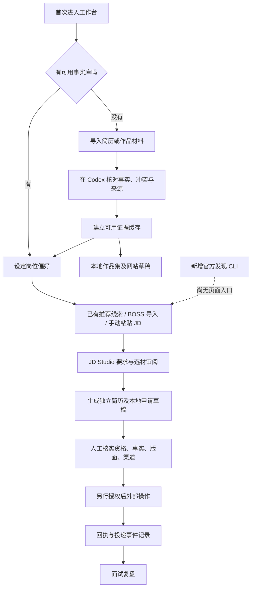

# Career Studio 全链路审计报告

日期：2026-10-16（Asia/Shanghai）。范围：本地完整工作台、公开静态演示源文件、P0 开发中的岗位发现模块。

**结论：当前分支可以审阅和在合成数据上预览，但未达到本轮 P0 功能验收、合并或生产部署条件。**

原有 150 项测试保持通过。最终 172 项测试中，164 项通过、8 项已知缺陷复现（expected failure）；不能把命令退出码 0 描述成全部需求通过。另有一个已实际复现、未纳入单元测试的旧规则缓存问题。新增岗位发现仍为 Python/CLI 原型，未接入现有页面/API，未完成材料回绑与刷新恢复。

用户要求审计后先汇报，因此审计阶段只增加测试、报告和证据，没有继续修复已发现缺陷或修改界面。没有真实投递、邮件发送、真实资料迁移、合并或生产部署。

## 1. 基线与保护范围

| 项目 | 记录 |
| --- | --- |
| 开发前本地提交 | `e32201c2cd49fcec36f8091e0b837c528086e267` |
| 原分支 | `codex/restore-classic-ui`，本轮开始时工作区干净 |
| 当前分支 | `codex/foreign-career-agent-p0` |
| 远程 main | 本轮只读核验为 `f107ddf3ce960d21293dee453293274e79d2868f`，不含本地后续 V2/经典 UI 恢复 |
| 另一个原始项目目录 | 有先前未提交修改，本轮未覆盖、提交或纳入本次变更 |
| UI 文件 | assets/public 共 12 个受控文件与基线逐字节相同 |
| 私有案例 | 审计开始建立 254 个文件摘要，结束比对全部相同；摘要明细仅本地保存 |
| Git 私有路径 | `job-search-cases/`、`generated/`、`material-inbox/`、真实 `.env` 均未跟踪 |
| 个人标识抽查 | 受控文本未检出当前候选人姓名、电话、邮箱的精确值；这不是完整历史秘密扫描 |

基线截图来自 `git archive e32201c` 导出的临时只读代码副本，在本次相同 Chromium、视口和合成数据上重拍；没有伪称是开发前已经拍摄的截图。此前 UI 恢复截图另见 `docs/ui-restoration/`。

保护证据：[汇总](evidence/preservation-summary.json)、[UI 文件摘要](evidence/ui-source-preservation.json)。

## 2. 变更影响与兼容性

| 文件 | 类型、原因 | 影响和回退方式 |
| --- | --- | --- |
| `scripts/foreign_eligibility.py` | 新增；在校、毕业窗口、地域化许可判断 | 被 JD 要求引擎调用；本轮规则尚有缺陷，回退时与调用方一起恢复 |
| `scripts/foreign_opportunities.py` | 新增；受限官方 GET、解析、快照、发现阶段登记、同岗位查重 | 仅 Python/CLI 可调用，没有页面或 HTTP 入口；移除该模块不会删除已有案例文件 |
| `scripts/jd_requirements.py` | 修改；将外企资格检查加入已有四状态判断 | 影响所有调用该引擎的 JD 分析/生成/策略排序；需逐项验证新旧规则并修复缓存版本问题 |
| `scripts/job_data.py` | 修改；允许 discovered/shortlisted 尚无简历；保留岗位 hash 路由 | 旧完整 Manifest 测试通过；普通页面锚点导致去重回归，见 F04 |
| `tests/test_foreign_opportunities.py` | 新增；来源、资格、导入、PDF、去重、恢复与缺陷复现 | 全部为合成数据/模拟网络；已知失败明确标注 expectedFailure |
| `tests/test_security_audit.py` | 新增；显式 LAN 模式的合成隐私复现 | 无真实候选人数据，不更改服务器配置 |
| `docs/career-agent-p0/` | 新增；可审查报告、日志、截图和核验依据 | 只含合成测试与公开岗位的最小必要说明；真实 JD 响应、候选人匹配和私有摘要不发布 |

没有删除文件、页面、按钮、导航、已有 API 或功能。没有更换布局、颜色、字体或组件。没有自动迁移数据、重写历史 job_key、改写提交事件或生成新版个人事实。

以上两项已有代码修改与本轮资格/岗位发现直接相关；没有发现无关 UI 修改。但 F04 是修改过宽造成的新去重回归。新增模块约束和字段尚未完整写入正式数据约定，不宜直接作为稳定 API 发布。

## 3. 当前功能与真实验证状态

“真实运行”指真实执行代码/本地 HTTP/浏览器；候选人、岗位输入和外部结果仍可为合成或模拟，不等于真实投递验收。

| 功能 | 状态 | 本轮证据与边界 |
| --- | --- | --- |
| 首页、六项导航、明确下一步 | 保持不变；浏览器通过 | 空案例、完整合成案例、前进后退、懒加载 JD 编辑器 |
| 职业画像、事实来源和原文审阅 | 保持不变；单元/HTTP/浏览器通过 | 真实案例只做来源校验，当前缓存受阻；见 F10 |
| 简历/作品集材料导入 | 保持不变；文本正常和异常路径通过 | PDF/DOCX 提取有代码和单元覆盖；本轮未做扫描件 OCR，也未人工遍历任意损坏 PDF |
| JD 分析、四类路由、证据选材 | 已有功能保留；部分资格规则改动 | 候选证据、优先级、来源查看、unsupported 拦截通过；新资格完整性尚不达标 |
| 中英文一页 PDF | 真实生成和文本提取通过 | 合成正常岗位在基线/当前分别生成 zh/en，选材、Markdown、PDF 提取文字与页数一致；非招聘方 ATS 实测 |
| 原有岗位推荐 | 保持不变 | 偏好保存/刷新通过；内置线索不等于真实在招列表 |
| BOSS 辅助筛选 | 保持不变；单元/HTTP/浏览器通过 | 本地导入、薪资条件更新、排除和未知核验时间；没有登录/爬取 BOSS |
| 投递准备与记录 | 保持不变，发现阶段校验放宽 | 实际执行本地登记、锁、附件哈希、unknown 恢复、事件幂等；外部提交结果用模拟/用户报告夹具 |
| 面试记录和复盘 | 保持不变；保存、关联、幂等、非法输入通过 | 浏览器导航可达；没有真实面试内容写入 |
| 作品集与个人网站 | 保持不变；本地生成/来源检查/预览通过 | 没有发布；外部既有个人网站链接未逐一核验 |
| DeepSeek 可选辅助 | 代码和入口保持不变 | 未使用真实 Key 调用服务；正常远端响应、配额和超时真实流程未验收 |
| 新增官方岗位发现 | 原型有真实公开 GET 运行 | 10 条来源检查；6 条响应具备 JD 与申请入口，4 条自动核验未知；还没有 UI 接入 |
| 岗位进入 JD Studio | Python 预填数据及生成器衔接的合成测试通过 | 浏览器按钮/API 未实现，因此不能宣称用户已经可以点击进入 |
| Gmail 跟踪 | 未实现/未修改 | 本轮未读取邮箱；此前元数据读取成功不证明后台同步或最小 OAuth scope 已核验 |
| 自动投递/自动发送 | 无此新增能力 | 新模块只有公开 GET 和本地记录；生成器不会投递；不得把本地 start 日志视为真实提交 |

## 4. 用户操作流程与产品逻辑

产品问题及建议（只建议，未改界面）：

1. 首页有下一步，但“核对事实 → 更新结构化缓存”仍依赖 Codex，页面无法完成闭环。建议在现有档案错误提示中给出具体过期来源及可复制恢复指令，不增加新首页。
2. 偏好推荐、BOSS、本地策略台各有入口。来源和核验标准不同，普通用户容易混淆。建议在已有筛选模块加一个来源选项和明确状态，保留原入口和行为。
3. 原 JD、公司和岗位信息需要跨工具搬运。建议新发现结果只通过既有 prefill 机制进入 Studio，不自动开始生成或改变投递阶段。
4. 材料生成、登记和授权执行是不同阶段。建议在原 Tracker 中显示缺失的准备项，不把生成成功显示成已投递。
5. 没有证据覆盖本轮“普通用户一分钟理解”结论。合成浏览器脚本通过不等于真实新用户研究；需要至少五名首次用户任务测试。

## 5. UI 回归

- 12 个 UI 文件逐字节相同；导航、按钮结构和原 CSS 完全保留。
- 基线与当前各真实生成 20 张截图，20 对像素完全一致。覆盖公开静态页本地副本、本地首页、JD 页及六个导航页面的桌面/手机状态。
- 360/768/1024/1440px 检查未发现横向溢出；390px 检查跳过链接和键盘焦点。真实 Chromium 桌面模拟视口，不等于 iPhone/Android 真机。
- 人工查看了本地桌面首页与移动 JD 表单截图，没有发现新增视觉变化。未逐像素人工查看全部弹窗和任意长度文本。
- 原有 Service Worker 注册被 CSP 阻断，基线与当前都可复现；没有放松 CSP 来使测试通过。
- **Vercel 线上页面未验收**：网页读取工具返回不可访问，浏览器标签操作超时。不能用本地 `/demo` 的通过结果替代线上部署。

证据：[像素对比](evidence/visual-comparison.json)、[基线浏览器结果](evidence/baseline/e2e-results.json)、[当前浏览器结果](evidence/current/e2e-results.json)。

截图示例：[基线桌面](evidence/baseline/local-desktop.png) / [当前桌面](evidence/current/local-desktop.png)、[基线手机](evidence/baseline/local-mobile.png) / [当前手机](evidence/current/local-mobile.png)。

## 6. 确认缺陷与复现步骤

### F01 — P0（条件性安全问题，基线已有）：LAN 模式没有独立身份验证

- 条件：显式以 `--host 0.0.0.0` 启动，且有其他客户端能访问这个端口。默认 127.0.0.1 模式不属于本复现。
- 复现：新客户端不携带任何既有凭据，GET `/api/bootstrap` 取得 token，再带 token GET `/api/workspace`，返回 200 和合成档案。
- 证据：`test_lan_mode_must_not_give_new_unauthenticated_client_candidate_data`，expected failure。实际 HTTP 经回环连接访问 LAN 配置，未从公网或真实局域网设备攻击。
- 原因：非回环 host 模式接受请求 Host，页面 token 只用于请求来源/会话校验，不是登录认证。
- 影响：启用 LAN 且用真实案例时，同网络可达客户端可能读取档案及生成材料；本轮没有证明实际泄露。
- 建议：真实资料继续仅回环运行；如保留 LAN，用启动时配对凭据保护 bootstrap、资源及预览全链路。不要只给某一个 API 加 token。

### F02 — P1（新增）：复合许可条件掩盖英语条件

- 复现：合成候选人只有确认的中国许可，没有专业英语证据；评估 `Required: Fluent English and China work authorization.`，返回 supported。
- 原因：外企补充检查只看到许可，全部补充项 supported 时覆盖原有英语未知判断。
- 影响：JD Studio、简历要求报告、策略/发现排序；当前发现模块仍强制 `ready_to_apply=false`。
- 建议：拆分全部原子条件，任何必需条件未知均不能整条 supported。
- 测试：`test_gap_compound_permit_must_not_hide_english_requirement`。

### F03 — P1（新增规则未完整纠正旧逻辑）：否定的中国许可错误否定英国许可

- 复现：合成候选人的 CN 范围许可 value=false；询问 UK 工作许可，返回 not_met，而非 unknown。
- 原因：旧分支先按全局 bool 得到 not_met，新检查保留该状态，没有按地域撤销结论。
- 建议：由同一带地域范围的原子检查独占许可判断；不把某地区的否定传播到其他地区。
- 测试：`test_gap_false_cn_permission_must_not_reject_uk_permission`。

### F04 — P1（新增回归）：普通页面锚点拆成重复岗位

- 复现：同职位 `/job/123#apply` 和 `/job/123#description`，当前 `job_data.canonical` 不相等；基线相等。
- 原因：为保留 hash 路由职位 ID，保留了所有 fragment；普通定位锚点也被当成岗位身份。
- 影响：去重不完整，可能产生两个准备记录；不能据此认定发生了真实重复投递。
- 建议：统一身份规范，区分 `#/jobs/ID` 路由与普通锚点，保留旧 job_key/aliases，不自动合并历史。
- 测试：`test_gap_ordinary_page_anchors_do_not_create_duplicate_jobs`。

### F05 — P1（新增）：登记中断后缺失 Tracker 不能恢复

- 复现：合成导入产生 Manifest 后，模拟进程在写 Tracker 前中断；再次导入同岗位返回 duplicate，Tracker 仍无记录。
- 原因：查到 Manifest 即提前返回，没有修复仅缺失的摘要行。
- 影响：原文未丢失，但岗位从现有看板缺失。新模块多文件写入不是事务。
- 建议：用现有锁与 Manifest 恢复缺失 Tracker，保留全部阶段/事件，不覆盖已有历史。
- 测试：`test_gap_discovery_resumes_after_manifest_before_tracker_crash`。

### F06 — P1（新增）：重复导入不会刷新核验

- 复现：第一次模拟官方返回 403，第二次模拟完整有效 JD；重复导入虽发出新 GET，但保存结果仍为旧 unknown。超过 24 小时的核验也没有刷新入口。
- 原因：duplicate 分支丢弃新观察。
- 建议：新核验作为独立观察追加，保留旧快照和岗位阶段；不要创建第二个申请。
- 测试：`test_gap_reimport_refreshes_previous_failed_verification`。

### F07 — P1（新增）：明确关闭的 Workday 岗位被泛化为 unknown

- 复现：合成官方 200 响应具有完整 JD，但 `canApply=false, posted=false`，解析结果为 unknown。
- 原因：只记录正向申请布尔，没有保留明确关闭状态。
- 影响：不至于误标可投，但无法准确排除并解释失效原因。
- 建议：区分字段缺失、明确拒绝申请、移除和读取失败。
- 测试：`test_gap_closed_flag_is_explicit_not_generic_unknown`。

### F08 — P1（已复现，基线分段覆盖缺口）：真实英文标题下硬门槛被遗漏

- 来源：[SAP 官方 STAR 职位](https://jobs.sap.com/en/jobs/744000154959197/student-training-rotation-program-consultant-2028-graduates/)。
- 复现：在 `What you'll bring` 下加入“全日制在校、2028 毕业”的强制条件，再接 Qualifications；输出没有包含这条毕业要求，却将一些后续介绍识别成 required。
- 原因：标题识别和 context 内容过滤过窄，单独新增资格正则并不能修复输入分段。
- 影响：新模块可读取真实 JD，但资格识别不完整；合成的 `Required:` 简短样本通过不能代表真实网页通过。
- 建议：保留 JD 结构、识别明确强制语义，对无法解释的资格段标 unknown；不要把整个公司介绍当要求。
- 测试：`test_gap_realistic_what_you_bring_heading_preserves_graduation_gate`；[真实 JD 分段证据](evidence/real-jd-segmentation.json)。

### F09 — P1（新增规则的兼容缺陷）：旧规则生成缓存仍被复用

- 实际复现：同一合成候选人 2023 年毕业，目标要求 2026/2027 毕业。先用基线生成，旧报告为 supported；再用当前代码生成同请求，返回 `reused=true` 且仍是 supported。
- 原因：生成 fingerprint 规则版本仍为 policy=2，当前新要求代码未参与缓存失效；缓存命中发生在重新评估前。
- 影响：新判断即使对冷启动样本正确，也不保证已有版本得到正确提醒。
- 建议：集中定义判断/选材规则版本，将其纳入 fingerprint；保留旧材料可读，明确旧规则版本需重新分析，不改写历史材料。
- 证据：[基线到当前的真实本地复现](evidence/rule-cache-reproduction.json)，不是单纯代码推测。

### F10 — P1（私有案例已有运行阻塞，非新增回归）：事实缓存来源已变化

- 复现：只读调用真实案例 `load_evidence`，抛出“事实源已变化，请先让 Codex 重新核对证据缓存”。
- 原因：证据源中包含持续更新的 coaching 文件；当前缓存没有同步完成事实复核。
- 影响：该案例无法生成新简历/作品集。安全拒绝是正确行为，不能直接改哈希放行。
- 建议：先在私有副本审核差异；再由用户确认可写回的派生缓存。后续分离事实版本与学习日志的版本依赖，不迁移历史申请。
- 私有证据仅本地保存，公开报告不含案例路径、姓名、联系方式或资料内容。

### F11 — P1（本轮需求未完成）：没有页面/API 和材料回绑闭环

- 复现：新模块仅能 CLI/Python 调用，现有导航/推荐列表没有新入口；服务器没有新发现接口。Python 返回的 Studio 预填尚无按钮使用。
- 生成器能读取导入 JD，但已有 Manifest 不会自动绑定生成材料，也不会为新材料另建清单。现有避免重复清单行为保留。
- 建议：复用原筛选模块、sessionStorage prefill、服务器 token 与写锁；只增加必要控件。将新材料引用绑定同一岗位，保持 discovered/preparing，禁止自动 ready/submitted。
- 完成前不能宣称“已整合 Career Studio”。

### F12 — P1（本轮真实运行发现的适配缺口）：有页面不等于能自动解析

- Bosch 官方页面 HTTP 200，网页读取可见完整要求和申请入口，但当前结构化解析器未提取出 JD，自动状态 unknown。
- Sanofi、Signify 的公开 Workday GET 返回 403；没有绕过限制。IKEA 链接网页工具返回 404，本地读取连接失败；保留两种观察的差异。
- 建议：对已允许的官方结构单独适配，保留正文与来源；403/动态页面交用户接手，不扩大为任意 URL 代理或绕过验证。
- 公开岗位来源见第 9 节；原始响应只在本地保存。

## 7. 风险与待验证项（没有冒充已确认 Bug）

| 级别 | 风险/待验证 | 依据和建议 |
| --- | --- | --- |
| P1 | 资格数据缺少当前学籍、地域化许可等字段 | 不能据本科已毕业猜测当前未在读；先确认事实，缺失维持 unknown |
| P1 | 中文/英文年限、毕业月份、最高经验上限覆盖不足 | 现有规则只覆盖部分表达；新增参数化边界样本后修复，不承诺通用自然语言理解 |
| P1 | 发现模块只筛部分地点/标题，没有完整应用当前六方向偏好 | 读了排除名单，但不能冒充完成 search-preferences 所有字段的匹配；后续加明确版本化筛选，不覆盖旧偏好 |
| P1 | HTTP 模式以外的官网/ATS 关联没有运行期证明记录 | 精确 tenant 白名单降低攻击面，但需保存企业官网到 ATS 的关联依据；不能泛化所有 ATS 租户都可信 |
| P2 | 外部 JD 提示注入 | 原文只作数据；新模块无工具执行、投递或发送。未运行未来工具型 Agent 的对抗测试，不能宣称该未来系统已防注入 |
| P2 | Key 与远端接口 | Key 仍在服务端环境变量；未用真实 Key 或远端服务验收。服务端 endpoint 配置仍需受可信管理 |
| P2 | Gmail 最小权限 | 本轮未重新读取授权 scope，后台未接入 Gmail；不能把连接器工具存在当作最小权限已验证 |
| P2 | 网络响应大小、动态 HTML、locale 和 UTF-8 变化 | 有响应上限和超时；不同官方页面仍需兼容测试，不扩大无限抓取 |
| P2 | 真实外部链接、真机、屏幕阅读器、招聘方 ATS | 尚未逐项验证；键盘/视口测试不能替代这些验收 |

没有发现本轮改动包含凭据、真实简历、外部发送代码或用户资料上传。文件路径越界、软链接、非法 Host/Origin/token 的既有回归测试通过。没有把模拟回执计入真实申请。

## 8. 测试执行与验收

| 测试 | 真实结果 | 说明 |
| --- | --- | --- |
| 开发前完整基线（带 PDF 依赖运行环境） | 150 通过 | 本轮真实运行，非引用上次日志 |
| 当前既有测试 | 150 通过 | HTTP、数据、生成、选材、记录、复盘、作品集等 |
| 最终全量 | 172 执行：164 通过，8 已知失败复现 | 8 个 expectedFailure 不算通过，不满足发布条件 |
| 指定 `python3 -m unittest discover -s tests -v` | 系统 Python：1 failure、2 error、11 skip，另有 8 expectedFailure | 缺 reportlab/pypdf；不是宣称所有系统 Python 都能直接运行 |
| 同命令使用含依赖的 Python | 164 通过，8 expectedFailure | 临时回环端口在受限环境被拒，获准开放测试端口后运行 |
| 现有 Chromium E2E（基线/当前） | 各 16 通过、1 blocked | 真实本地浏览器，所有数据合成；blocked 为既有 CSP/worker 问题 |
| 视觉对比 | 20/20 对像素相同 | 相同 Chromium 与视口 |
| 中英文材料对比 | 两种语言语义输出一致 | 合成正常岗位，Markdown/选材/PDF 文本/页数；PDF 元数据不作二进制等同要求 |
| 真岗位网络检查 | 10 条，自动 6 个 verified_open、4 个 unknown | 证明读取时入口状态，不证明候选人资格或未来仍开放 |
| Vercel 线上验收 | blocked | 工具不可访问/超时；没有线上截图 |
| `git diff --check` | 通过 | 包括本轮代码和文档 |

原始记录：[基线测试](evidence/baseline-unit-tests.txt)、[当前测试](evidence/current-unit-tests.txt)、[系统 Python](evidence/system-python-tests.txt)、[当前浏览器日志](evidence/current-browser-tests.txt)、[PDF 对比](evidence/pdf-regression.json)。

对本轮原定六个验收点的回答：

1. 有效 JD 导入：合成 HTTP 响应下本地登记通过；真实公开 GET 已运行；真实用户页面入口尚未实现。
2. 毕业资格：显式 Required 样本可识别不符，但真实标题分段遗漏，未通过完整验收。
3. 同岗位去重：规范化查询参数样本通过，普通锚点和中断恢复失败，未通过完整验收。
4. 无真实来源不能已核验：客户端不能传 verified 字段，空正文/跳转/断网不能标 verified_open，来源快照篡改会失效；测试网络为模拟，不是证明所有来源语义都正确。
5. 进入简历流程：Python 调用和英文 PDF 通过；浏览器入口及材料回绑尚未完成。
6. 不会未经授权发送/投递：本轮没有对应执行能力，新模块仅 GET；发现阶段 start 校验被拒。没有尝试真实提交来验证拦截。

## 9. 首批十条真实来源检查

日期：2026-10-16。下面是读取结果，不是十条可直接投递推荐。候选人的逐项匹配与事实引用仅保存于本地私有审阅文件，避免个人背景进入公开仓库。

| 企业与岗位 | 官方来源/编号 | 自动检查结果 | 必须保留的限制 |
| --- | --- | --- | --- |
| Welo AI Trainers Network — Chinese (Simplified) | [官方 JD](https://jobs.lever.co/weloglobal/b426802e-e06a-48a9-94cf-58741da49675)；UUID 见链接 | verified_open | 人才库，自由职业；不是保证有项目；发布日期未知 |
| Welo Generative AI Analyst — Simplified Chinese | [官方 JD](https://jobs.lever.co/weloglobal/c169172d-6b2e-45a8-885d-78723b1a7a1c) | verified_open | 列表含中国，正文列出的地区不含中国；需核实 |
| Welo Generative AI Analyst — Traditional Chinese | [官方 JD](https://jobs.lever.co/weloglobal/60e35ef5-b3d7-4e95-867c-af67d294ccc4) | verified_open | 繁体中文能力与雇佣地区需核实；日期未知 |
| Wing AI & Tech Internship Program | [官方 JD](https://jobs.lever.co/getwingapp/749ebeca-a4aa-4351-9634-edddfd485f1a) | verified_open | 中国远程、无薪 3–6 个月；不是默认可接受 |
| Cerence Intern UX | [官方 JD](https://cerence.wd5.myworkdayjobs.com/Cerence/job/Shanghai/Intern-UX_R0006036)；R0006036 | verified_open | 上海兼职；必须在读；官方 startDate 2026-10-08 |
| Sanofi Digital Product Intern — Sales Line | [官方线索](https://sanofi.wd3.myworkdayjobs.com/en-US/SanofiCareers/job/Digital-Product-Intern---Sales-Line_R2867936) | unknown，HTTP 403 | 完整资格、日期和当前申请状态未知 |
| Signify Product Management Intern | [官方线索](https://lighting.wd3.myworkdayjobs.com/en-US/jobs-and-careers/job/Shanghai/Product-Management-Intern_365461) | unknown，HTTP 403 | 不从旧摘要补填条件或发布日期 |
| SAP STAR Consultant — 2028 Graduates | [官方 JD](https://jobs.sap.com/en/jobs/744000154959197/student-training-rotation-program-consultant-2028-graduates/)；REF1694T | verified_open | 强制全日制在校、2028 毕业；官方日期 2026-10-12 |
| Bosch 产品经理_VM | [官方页面](https://jobs.smartrecruiters.com/BoschGroup/744000126660749)；744000126660749 | unknown，解析不足 | 人工可读并有申请入口，苏州全职、3 年以上产品/咨询；自动状态不擅自提升 |
| IKEA Digital Product Intern GPC | [失效线索](https://jobs.ikea.com/en/job/shanghai/digital-product-intern-gpc/24107/99707567392) | 本地 unknown；网页工具 404 | 不能标记仍可申请；日期与资格未知 |

没有为了凑十个“符合”而降低资格、补造岗位或把人才库写成正式工作。没有把这些审计线索登记进真实候选人的申请记录。

## 10. 最小修改方案与发布门槛

建议的后续顺序；本次没有执行这些修复：

1. 确认真实资料继续仅本机预览；若必须 LAN，先解决 F01 的身份保护。
2. 只修外企资格原子化、真实 JD 分段和规则缓存版本（F02/F03/F08/F09）。保持四状态输出及旧材料可读。
3. 修复链接身份、幂等恢复、核验刷新和关闭状态（F04–F07），保留原 Tracker/Manifest/事件三者职责。
4. 在原有筛选区域增加最少入口，复用既有 JD prefill；补材料回绑和错误恢复（F11/F12），不换 UI。
5. 审阅私有缓存变化后再恢复真实案例生成（F10）；不自动修改事实或历史。
6. 将对应 expectedFailure 转为正常断言并通过；重跑现有测试、浏览器与截图对照，再申请合并。

发布门槛：P0 适用条件得到控制；本轮 P1 修复；八项已知失败复现清零；旧规则缓存正确失效；页面闭环完成；真实来源、权限及恢复验收有证据。CI 绿色本身不足以解除这些门槛。

回退基准为 `e32201c`。建议切换到该提交的独立分支/工作树进行预览，或在实施分支使用可审查的反向提交；不使用 `reset --hard`、`clean` 或回退整个 main。新增审计数据可保留，个人事实库和历史记录无需迁移或回滚。

远程 main 与本地基准存在历史差距。若提交审阅 PR，应以经典 UI 基准分支为 base 建立草稿 PR，避免把先前全部 UI 恢复误算成本轮改版；先前基准进入 main 的问题单独审阅。不得自动合并、开启自动合并或部署生产。
