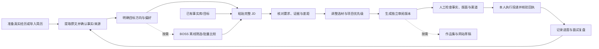

# 用户任务路径

One clear path, multiple optional tools.

## 五种场景

| 场景 | 从哪里开始/准备什么 | 点击后的结果 | 下一步与错误恢复 |
|---|---|---|---|
| 没有简历 | 首页「上传简历」；没有文件可先在 Codex 口述一段经历 | 本地提取原文，保留待复核材料 | 用综合整理指令核对来源与冲突；扫描件需文字或 OCR；输入不丢失 |
| 已有完整简历 | 首页「分析新岗位」；准备完整 JD | 要求与事实矩阵、方向依据、全部选材 | 未更新缓存时在档案复核再刷新；已有事实无需重访谈 |
| 运营转 AI 产品 | 岗位与简历，准备运营事实和个人 AI 实践 | 直接/相邻/未知分开，生产能力不推定 | 补可追溯的职责证据；练习不得当业务成果 |
| 三方向同时申请 | 共用事实库；分别打开三份 JD | 每份 JD 独立 request、selection、材料版本 | 项目优先级只改变本版选材；不要合并不同岗位 |
| 只改一个 JD | 直接进入 `/studio` | 分析、优先项目、取舍与独立版本 | 相同请求复用结果；变更 JD/事实/优先级才生成新版本 |

每个结果说明当前状态、产生的文件与下一步。生成成功默认 `preparing`，不升级成已投递。旧资料无需重做，作品展示可跳过。

「一分钟内理解」是待真人验证的产品目标。本轮浏览器场景验证入口、结果和恢复路径存在，不能代替用户计时理解测试。
