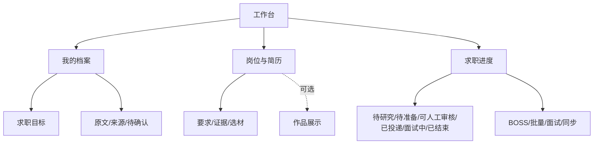

# 信息架构与功能归属

| 一级入口 | 主任务 | 保留的次级工具 |
|---|---|---|
| 工作台 | 当前最重要的行动、目标、字段完整度、待确认事实、最近岗位、未完成材料、真实投递 | 展开查看事实标签统计 |
| 我的档案 | 导入与核对材料，原始事实库、待确认项，目标/地点/偏好 | 复制 Codex 综合整理指令 |
| 岗位与简历 | 完整 JD → 要求/证据 → 选材 → 独立材料 | 原有 Word 版本、七视角审计、逐项练习/7 天计划 |
| 求职进度 | 六种看板阶段、真实状态与下一步 | 面试复盘、批量选岗、BOSS 离线筛选、公司线索、DeepSeek 摘要、投递/同步任务 |
| 作品展示 | 选项目、沿用 JD 选材，生成作品集和本地网站草稿 | 原网站链接、网站更新任务 |

不删除已有功能。面试复盘仍保留原路由 `#interview`，从求职进度进入，导航归属求职进度。`#overview/#assets/#resume/#applications/#website` 与 `/studio`、`/strategy` 保持兼容。

看板是既有数据的展示映射，不改历史枚举或投递 CSV：discovered → 待研究；shortlisted/preparing → 待准备；ready → 可人工审核；submitted/assessment → 已投递；interview/offer → 面试中；rejected/withdrawn/closed → 已结束。Offer 仍显示原始阶段，不暗示正在面试。
