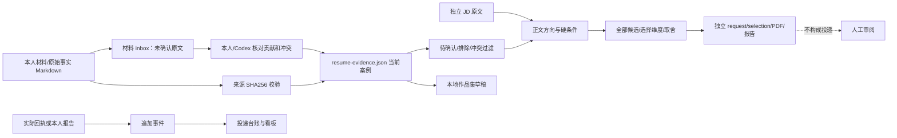

# 数据质量、事实来源与缺陷分类

## 已确认 Bug（有代码位置或复现证据）

| ID | 复现与原错误 | 修复及验证 |
|---|---|---|
| B01 | 公共文化管理合成候选人的硕士判断理由写成「商务英语本科」 | 动态读取当前教育记录；不同候选人回归 |
| B02 | `生产级 RAG 系统维护` 被 AI 内容标签/指南证据判 supported | 必须有直接表述；相邻/深度未证实用 partial；硬门槛、报告、UI、批量结果同步 |
| B03 | 空经历判断「至少10年用户运营」为 not_met | 不完整事实用 unknown/partial；not_met 需明确完整性或否定事实 |
| B04 | 双休标签与「每周六必须加班」被判 shortlist | 周末固定加班明确排除；偶尔加班与双休并存待核实 |
| B05 | 第三个 OCR 工作要点受固定两条上限遗漏 | 删除条数/项目数截断，按相关性与篇幅选择；全部候选留痕 |
| B06 | 原 Service Worker 除三个前缀外缓存所有请求，覆盖作品集预览 | 同源 GET 外壳白名单，旧缓存升级清理；浏览器检查缓存 |
| B07 | 推荐理由直接读缓存标签，未校验事实源变化 | 共用 load_evidence 和有效事实过滤；过期后不再引用标签理由 |
| B08 | 同 URL 在 generated 中再生成仍可创建新 manifest | 查 applications 与 generated；相同请求复用，变化保留新版本而不重复清单 |
| B09 | 同岗位 ID 的薪资/描述冲突未检查，只比较公司/标题 | 比较全部有效条件，冲突待核实，保留两条来源 |
| B11 | 只有 attempt_result/submitted、无开始事件或回执的记录被计作确认投递 | 校验开始与结果时间、来源和证据文件；不完整不计数，保留警告 |
| B10 | 旧 JD 作品集只比源摘要；缓存内容修改但源文件未变不能被新版本识别 | 新 selection 存完整缓存摘要，更新后阻止沿用；旧版本保留恢复 |

最初五条输入/输出保存于 `evidence/confirmed-reproductions-before.json`，B05/B07/B09/B11 的追加复现见 confirmed-reproductions-additional.json；B06/B08/B10 的代码机制与新增回归一并检查。不是所有 Bug 都有线上复现：线上不可访问，以上是本地代码/合成数据证据。

## 已改善的体验或能力缺口（不冒充 Bug）

任务首页；目标入口；五个导航；三列岗位决策；未选证据；优先项目；薪数/年薪显式字段；条件来源与未知；个人化 7 天计划取消固定候选人 ID；静态页面能力边界。

## 基于代码推测、尚未证明消除的风险

规则引擎对复杂否定、英文复合条件、跨句优先项可能解析不足；中文点分月份以整月并集计算，不能精确到天；原始材料真实性及缓存表述与原文语义一致性需要人核对；旧 v1 selection 没有完整缓存摘要；手工编辑的旧 tracker 可能缺回执；岗位链接 ID/别名不能自动证明同一岗位。详见 08。

## 数据兼容与保护

保留 schema_version=1；新增 confirmation_status/status、confirmed、conflict/conflicts、unconfirmed 引用及完整性字段。没有这些字段的旧档按原有来源校验读取，标注 legacy 并要求人工复核，不能宣称自动确认。明确 pending/conflict/rejected 不用于材料。

not_met 的完整性字段必须来自确认：`person.education_complete`、`person.experience_complete`。不自动给真实案例补 true；仅合成夹具明确设置，以验证完整事实中的明确不满足。能力/意愿可用 `person.capabilities.<key>={status:'confirmed',value:true/false,source_ref:...}`。

未修改真实事实库、历史事件、台账或已提交附件；没有操作外部平台。新审阅版本保存在 generated；旧版本可查看，事实变更后重新生成并重新审核，不能拿旧版本自动升级 ready。
